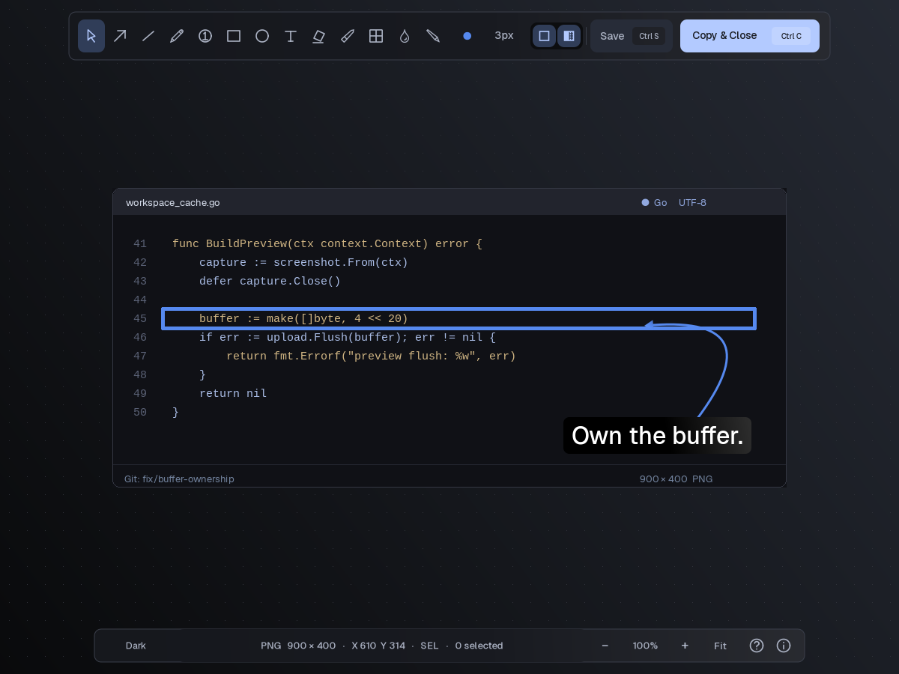
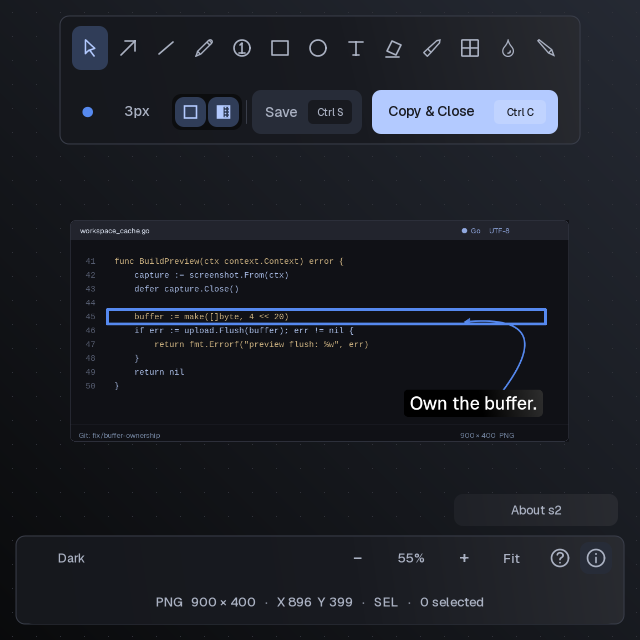
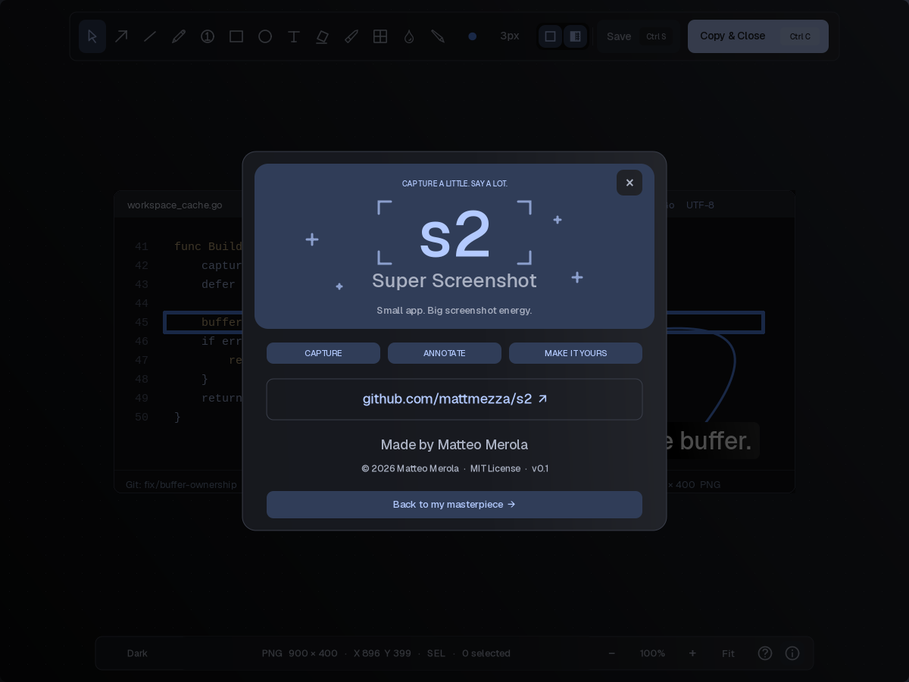

# s2 — Super Screenshot

A native, keyboard-first screenshot editor for X11. Annotate, highlight, redact, and copy your capture without leaving the keyboard.



## Get started

```sh
make
maim -s | ./s2 -i -
```

Draw a shape, then edit the selection. **Ctrl+S** saves and exits; **Ctrl+C** copies and exits. **Enter only finishes text entry**. In regular windows, **Esc deselects**; in `--modal` windows, Esc can cancel and quit. The `?` button opens shortcut help; the info button opens About.

```sh
s2 capture.png                       # regular, tileable window
s2 --modal -i capture.png            # request a centered floating dialog
s2 -i capture.png -o annotated.png   # Ctrl+S writes this explicit path
maim -s | s2 --modal -i - -D /tmp    # timestamped saves in /tmp
```

Without `-o`, Save/Ctrl+S creates `YYYY-MM-DDTHHMMSS.ffffff.png` in the configured save directory. Seconds and microseconds prevent minute-level collisions; exclusive file creation adds a numeric suffix if a name already exists. Explicit `-o` paths may be overwritten. Successful save, copy, cancellation, and WM Quit return `0`; input/output failures return nonzero.

## Build and install

Requires a C11 compiler, Make, CMake, Python 3 (with HTTPS support), pkg-config, X11/Xft/FreeType, Fontconfig, libpng, Pango, Cairo, and HarfBuzz. Clipboard operations use `xclip`; repository links use `xdg-open`. `maim` and `slop` are optional capture tools.

On Arch Linux:

```sh
sudo pacman -S base-devel cmake python pkgconf libx11 libxft freetype2 fontconfig libpng pango cairo harfbuzz xclip xdg-utils
# Optional capture tools:
sudo pacman -S maim slop
make
sudo make install
```

The default prefix is `/usr/local`; edit `config.mk` or use `make PREFIX=/your/prefix install`. Installation includes the executable, man page, and project, font, CUI and Clay licenses. The first `make` downloads CUI at the revision in `cui.lock.json` and verifies its SHA-256 checksum. Later builds use the local `vendor/cui` cache. Run `make deps` to fetch it ahead of time. Release source archives include CUI and can build offline.

The executable embeds Geist upright/italic variable fonts, icon masks, cursors, and the font license. It needs no adjacent asset files, API key, or installed Geist fonts. It still links to the platform libraries above. `s2 --licenses` prints the embedded font license.

## Draw and edit

| Keys | Action |
| --- | --- |
| `s`, `a`, `l`, `p` | Select, arrow, line, pen |
| `r`, `o`, `t`, `n` | Rectangle, circle, text, numbered pin |
| `h`, `m`, `b`, `x` | Highlight region, marker, blur, pixelate |
| `c` | Sample a color from the capture |
| `[` / `]` | Adjust the tool or selection dimension |
| `1`–`9` | Palette foreground/stroke color |
| `Shift+1`–`Shift+9` | Selection fill color, where supported |
| `f` | Toggle fill |
| `Shift+F` | Toggle rectangle/circle outlines |
| `g` | Toggle gradient fills |
| `Ctrl+Z` / `Ctrl+Shift+Z` | Undo / redo |
| `Delete` / `Backspace` | Delete selection |
| `Ctrl+V` | Paste text |
| `Ctrl+S` | Save and exit |
| `Ctrl+C` / `Ctrl+Y` | Copy and exit / copy and keep editing |
| `?` | Shortcut help |

Drag to draw. Shapes, strokes, pins, and committed text automatically switch to Select. Drag selected objects to move; drag empty space for a marquee selection. Reselecting Number (`n`) resets numbering to 1 while retaining the chosen size.

Selected objects expose square resize handles and a round rotation handle. Hold Shift while drawing for square/circular proportions, while resizing to preserve aspect ratio, or while rotating for 45° increments. Lines/arrows snap to horizontal, vertical, or diagonal while drawing with Shift.

**Curves and arrow ends:** drag the midpoint diamond of a selected line/arrow to bend it; Shift-drag straightens it. On selected arrows, `e` cycles end styles and `Shift+E` cycles backward. `<` and `>` toggle the start and end. Styles include open, filled, outlined, diamond, dot, and bar.

**Colors and fills:** the color control opens a palette with custom hex entry and image sampling. With a selection, Stroke/Text and Fill tabs choose the target; Shift-click the control opens Fill directly. Rectangles, circles, and text have independent foreground/fill colors. The two square toolbar controls toggle outline and fill independently. A dotted fill icon indicates gradients; a slashed outline icon indicates no outline. `g` and Shift+F update compatible selected objects and the defaults for future objects; existing unselected objects retain their appearance.

**Dimensions:** brackets change selected rectangle/circle outline widths by 3 px, text/number size by 8 px, marker width by 8 px, blur radius by 3 px, and highlight strength by 5 percentage points. Other stroke widths and pixelate blocks use 1 px steps. The dimension picker offers explicit values.

### Text

Click with Text, type, then press Enter to commit and select it. Press `t` on selected text to edit in place. The single-line editor supports a caret, arrows, Home/End, Shift selection, Ctrl+A, Backspace/Delete, and paste. Esc cancels the edit; clicking outside finishes entry. Clipboard copy shortcuts export the image, not selected text.

| Selected-text keys | Action |
| --- | --- |
| `b` / `B` | Lower / raise font weight by 100 |
| `i`, `u`, `s` | Toggle italic, underline, strikethrough |
| `p` / `P` | Decrease / increase padding by 1 px |
| `c` / `C` | Decrease / increase corner radius by 4 px |
| `[` / `]` | Decrease / increase font size by 8 px |
| `1`–`9` / `Shift+1`–`Shift+9` | Foreground / background color |

Text styling keys take precedence over tool shortcuts while text is selected; choose another tool in the toolbar when needed. Defaults are Medium weight (500), 32 px size, and 12 px background padding.

## View and themes

- `+` zooms in, `-` zooms out, and `=` fits the capture (`0` is an alias).
- Ctrl+wheel zooms around the pointer. Ctrl+left-drag pans; Fit resets panning.
- Click the footer theme name, press Alt+C, or Alt-click the color control for themes. Alt+1–9 selects Dark, Light, Tokyo Night, Gruvbox, Dracula, Nord, Catppuccin, Solarized, or Rose Pine.
- Both bars remain centered. Narrow windows wrap the tools/actions and footer details into additional rows.
- View changes and chrome never affect exported capture dimensions or pixels.





## Configure

`make` creates `config.h` from [`config.def.h`](config.def.h) only when it is missing. Edit `config.h`, then rebuild. It is intentionally ignored by Git. Keep a backup before replacing it with refreshed upstream defaults.

Configure palette, save directory, tool dimensions, font, text styling, and theme mappings. `S2_DEFAULT_GRADIENT_FILL` and `S2_DEFAULT_SHAPE_OUTLINE` control initial appearance (both enabled). `S2_ARROW_EDGE_CYCLE` controls end-style order and `S2_DEFAULT_ARROW_EDGE_STYLE` its initial value. Theme presets and modifier are defined with `S2_THEME_PRESETS` and `S2_THEME_MODIFIER`.

See [`docs/CONTROLS.md`](docs/CONTROLS.md), `man s2`, and `s2 -h` for details.

## Development and checks

CUI is downloaded at the exact revision in [`cui.lock.json`](cui.lock.json); its source is cached locally and is not tracked by Git. The native X11/Cairo/Pango editor paints CUI chrome while caching capture pixels on the X server. Drawing coalesces consecutive pointer motions, retains freehand points, and uses cropped previews; final exports render at capture resolution.

```sh
make test-text test-blur
python3 tests/exit-codes.py
python3 tests/about.py
python3 tests/connectors.py
python3 tests/smoke.py
# Optional 4K motion/performance comparison:
python3 tests/motion.py
```

Native checks require Xvfb, xdotool, xclip, and ImageMagick's `import`. They run on private virtual displays, never on your desktop. The About test stubs the browser launcher. See [`tests/PERFORMANCE.md`](tests/PERFORMANCE.md) for measurement limitations and [`assets/README.md`](assets/README.md) for asset provenance.

Regenerate the documentation images with `python3 scripts/render_screenshots.py` (also requires Pillow). It renders synthetic code on a private display; no real workspace contents are captured.

## Website and releases

`make site` installs the locked website dependencies and builds the static Tailwind CSS site into `site/dist` (requires Node.js and npm). The GitHub Pages workflow builds and deploys it when `main` changes.

To publish a release, update `VERSION` in `config.mk` and add the matching `vX.Y.Z` heading to `CHANGELOG.md`, then commit all changes and run:

```sh
make release name=v0.1.0
```

This runs the native regression checks and website build, packages tracked source plus the pinned CUI dependency into an offline source archive, writes SHA-256 checksums, creates an annotated tag, pushes the branch and tag, and publishes a GitHub release. It requires GitHub CLI authentication and the test dependencies listed above. `make dist` creates the source archive from the current commit without publishing.

## License

MIT © 2026 Matteo Merola. See [LICENSE](LICENSE). Geist is distributed under the [SIL Open Font License](assets/fonts/OFL.txt); CUI includes its own [license](https://github.com/mattmezza/cui/blob/ab8fddbbbca4b78e3b2cc1b14752dd0c4ac96b30/LICENSE).

[GitHub repository](https://github.com/mattmezza/s2)
